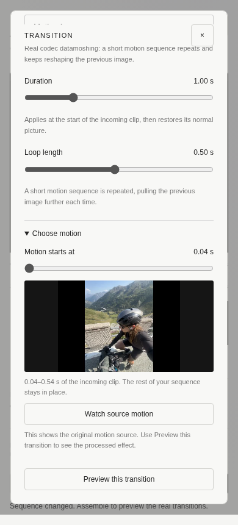

# Motion Loop and motion-source selection

[Compare all three modes](demo/motion-loop/comparison.mp4?raw=true):
**left Classic Mosh, middle Frame Melt, right Motion Loop**.
[Download Motion Loop alone](demo/motion-loop/motion-loop.mp4?raw=true).


All three renders use the same original MOVs, 640×480, 24fps, a 2.5s effect and
motion starting 0.5s into the P-frame sequence. Melt repeat=4, Loop group=8 frames.
The source files are not included or modified.

## Use in the editor

Select a connector, then choose a method:

- **Classic Mosh** advances through the incoming clip's compressed predictions.
- **Frame Melt** repeats each compressed prediction, accumulating drag.
- **Motion Loop** repeats a short group of predictions, creating recurring motion
  that continues to reshape the preceding image. It does not loop decoded images.
- **Cut** is an ordinary cut and hides effect controls.

Duration keeps its existing meaning: how long the effect occupies the start of
the incoming clip before its normal picture is restored. Motion Loop exposes a
**Loop length** slider (2–48 frames, about 0.08–2s). The effect must be longer than
one loop, so at least one motion frame is replayed. Very short incoming clips
with fewer than three P-frames cannot use this mode.

Open **Choose motion** only when needed. The source-position slider shows the
actual time in the incoming clip; its preview and **Watch source motion** button
show the unprocessed donor movement. **Preview this transition** renders and plays
the actual datamoshing instead. Available ranges stay within the clip and adjust
to duration, repetition and loop length. Existing Classic/Melt settings retain
their previous behavior when no new source offset is selected.

Selecting motion does not trim/reorder the incoming clip. Its ordinary remainder
still resumes at the existing timeline position after the effect; a visible reset
can occur. There is no new reset scheduler, H.264 datamoshing implementation or
independent motion-vector transfer in this release.

## Processing API and exact reproduction

The existing `process(effect, a, b, transition_duration, output, parameters)` API now
supports `motion-loop` and `motion_start` on all three effects. Source selection is
quantized to 24fps. `motion_start` is a nonnegative offset in seconds from the first
P-VOP; zero preserves the old behavior. Since the initial I-VOP is excluded, an
API offset of 0.5s corresponds to source frame 13 (0.541667s), which is what the UI
shows. The CLI still prepares at most six seconds per source; the editor continues
to prepare full clips up to its existing 120s limit.

```sh
python3 tools/effects.py --effect motion-loop \
  --a /path/a.mov --b /path/b.mov --duration 2.5 \
  --motion-start 0.5 --loop-frames 8 --output output/motion-loop.mp4
```

`loop_frames` is an integer 2–48, smaller than the output effect frame count and
no larger than the available donor window. The default adapts to shorter clips
(up to 12 frames). `repeat` remains exclusive to Frame Melt. Unsupported parameters
are rejected by the processing API. Sequence transition JSON accepts `effect`,
`duration`, `motion_start`, plus the relevant `repeat` or `loop_frames` setting.

The shared `prediction_plan` validates all indices before sequence assembly. With
8 loop frames and the offset above, the donor order is 13…20, 13…20, …; each VOP's
payload remains byte-identical. Replaying those compressed predictions applies
motion and residuals to the evolving decoder reference, unlike a repeated decoded
clip. Normal-reference restoration and output timing use the existing sequence
path. Original-file hashes, chosen indices, parameters and VOP payload hashes are
retained in the ignored evidence directories.

## Validation

16 integration tests passed, including the original Classic/Melt regressions,
selected donor windows, exact loop payload order, repeated-cycle images that differ,
visual difference from both older modes, parameter boundaries, invalid windows,
full decoding, source preservation and reference restoration after a loop.

A Chromium browser test with the two actual MOVs and one synthetic clip verified
mode-specific controls, source-motion playback, selected ranges reaching the actual
render, settings/reload persistence, real preview, scrub, download, error/retry,
removal and media cleanup. It also checked expanded controls at 390px width. No
JavaScript errors were recorded. Mac/Safari execution remains untested here.

The three real-footage proof renders each contain 130 frames (5.416667s), and all
fully decode. At frame 105, Motion Loop differs from Classic by mean absolute RGB
error 35.13/255 and from Melt by 29.65/255. Representative strips were visually
inspected; Loop accumulates repeated directional deformation while the other
modes advance differently. This demonstrates distinction, not guaranteed artistic
quality for every source. See `demo/motion-loop/comparison.json` for summary metrics.

No new dependencies. Engine algorithms and UI controls are independently
implemented; no Supermosh source code was copied. Segment repetition was informed
by inspecting its public implementation; our native MPEG-4 path is retained.
