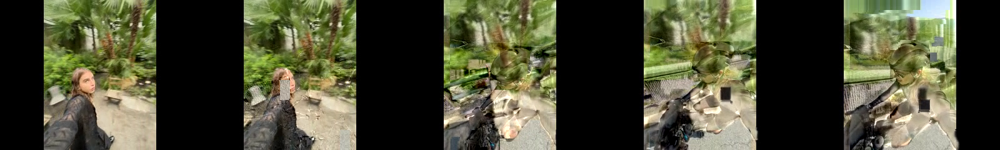
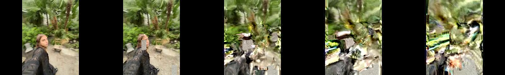

# Phase 2 — verified effects and API

[Watch/download the comparison](demo/phase2/comparison.mp4?raw=true) — left Classic, right Melt.

[Classic MP4](demo/phase2/classic-mosh.mp4?raw=true) · [Frame Melt MP4](demo/phase2/frame-melt.mp4?raw=true)





Current normalization, previews and exports are 640×480; the Phase 2 demo
files and measurements below document the earlier 320×240 run.

Result: Classic Mosh preserved; one new codec-level effect, Frame Melt, verified.
Motion Transfer is blocked, not an alias or an advertised API mode. No UI work.

## Dependencies and reproduction

Same Python 3 standard library + FFmpeg/FFprobe (`mpeg4`, `libx264`) as Phase 1.
Linux x86-64, FFmpeg 7.1.5 tested. On Apple Silicon, `brew install ffmpeg python`;
Mac execution has not been independently verified.

```sh
# Unchanged original synthetic workflow:
python3 tools/mosh.py --synthetic
python3 tools/verify.py
# Integration regressions, isolated temporary samples and outputs:
python3 -m unittest discover -s tests -v
# Compare the verified effects, using your own inputs:
python3 tools/compare.py --a /path/IMG_3194.MOV --b /path/IMG_1993.MOV --duration 2.5
# Individual renders:
python3 tools/effects.py --effect classic-mosh --a /path/a.mov --b /path/b.mov --duration 2.5 --output output/classic.mp4
python3 tools/effects.py --effect frame-melt --a /path/a.mov --b /path/b.mov --duration 2.5 --repeat 4 --output output/melt.mp4
```

`compare.py` writes `output/phase2/comparison.mp4`: **Classic on the left, Melt on
 the right**. It also writes individual MP4s, preview strips and `comparison.json`.
It fails if the selected middle frames are not materially distinct on the given
source pair; this is a diagnostic threshold, not a guarantee of artistic quality.

## Common local processing API

```python
import sys
sys.path.insert(0, 'tools')  # from repository root
from effects import EFFECTS, process
report = process(
    effect='frame-melt', a='/path/a.mov', b='/path/b.mov',
    transition_duration=2.5, output='output/melt.mp4',
    parameters={'repeat': 4},
)
```

`EFFECTS` describes only verified identifiers and meaningful parameters:

| Identifier | Parameters | Compressed-domain behavior |
| --- | --- | --- |
| `classic-mosh` | None | A I/P sequence, then sequential B P-VOPs without B I-VOP |
| `frame-melt` | `repeat`: integer 2–12, default 4 | Each selected B P-VOP replayed `repeat` times against the evolving reference |

Both use the same Phase 1 normalization function. A contributes up to six seconds;
`transition_duration` specifies the subsequent effect segment, not total duration.
Duration is 1/24–6 seconds, rounded to nearest 24fps frame. B must contain at least
that many P-frames after normalization; the API rejects too-long requests. Sources
must each yield at least two frames. Both outputs have identical frame counts for
an equal duration. There is no post-effect B continuation or audio in this proof.
Melt advances through B more slowly: a 60-frame segment with repeat=4 uses the
first 15 B P-VOPs. Unsupported effects/parameters and source-overwriting output
paths raise errors. FFmpeg errors propagate as failures.

Output must be a separate `.mp4`. Adjacent `<output-stem>.evidence/` retains the
normalized A/B streams, manipulated elementary stream, and verification JSON.
These intermediates contain private footage: keep them local. Regeneration
replaces the named generated outputs/evidence; inputs are hashed and never edited.
Do not run concurrently with identical output paths. This synchronous Python API
is ready for a future server worker; it is not an HTTP/upload/security layer.

## Why Frame Melt is different

Melt repeats **compressed predictions**, not decoded images. Each replay applies
the same motion vectors and residuals to the result of the preceding replay.
That creates accumulating drag/warping, rather than a hold frame or slow-motion
frame duplication. Payload bytes are unchanged, including their original internal
VOP times; the no-B-frame raw-stream decoder processes them in input order and
FFmpeg's explicit 24fps input cadence regenerates output timing. Both the raw
manipulated stream and final MP4 are fully decoded with `-xerror`, and expected
frame counts are checked. This timing approach is verified here with FFmpeg;
the raw elementary stream is not a portable delivery format. Deliver the MP4.

Classic takes each consecutive B P-frame once. It progresses through B's actual
motion, whereas Melt compounds a smaller set of predictions on the retained A
image. Neither uses shaders, optical-flow warping, crossfades or decoded blending.
Both still include B's residuals and possible intra-coded macroblocks, not just
motion vectors. This is why neither should be presented as pure Motion Transfer.

## Evidence

Six integration tests passed, exercising real FFmpeg encoding and decoding:

- Original Phase 1 CLI and verifier run successfully on isolated synthetic clips;
  new Classic payloads and configuration match the corresponding legacy prefix.
- Melt's VOP sequence exactly equals the expected fourfold-repeated B P payloads.
  The first four decoded images are all different, excluding a decoded-frame hold.
- Both outputs decode to 204 frames on six-second synthetic A + 2.5s transition;
  decoded A prefixes are identical; selected effect images materially differ.
- Repetition endpoints 2 and 12 render and decode with the expected VOP sequences.
- Input hashes are unchanged.
- Unverified modes, unsupported parameters, bad durations and input overwrite fail.

Real-footage validation used the same previously supplied clips: A=IMG_3194.MOV
(2.9s), B=IMG_1993.MOV (3.731667s), both HEVC 1920×1440, nominal 30fps with portrait
orientation metadata handled by FFmpeg's autorotation. Each result contains 70 A
frames plus 60 effect frames: 130 frames, 5.416667 seconds at 320×240/24fps.
Both raw manipulated streams, both MP4s and the side-by-side MP4 decode completely.
VOP indices and byte hashes, source hashes, probes, and quantitative comparison
are saved locally in each output's evidence directory and `comparison.json`.
At the middle comparison frame (100), Classic versus Melt mean absolute RGB
difference was 32.082/255. Only delivery videos and image strips are included
in the published demo; originals and raw evidence stay outside Git.

Representative strips were inspected: Classic progressively brings in the bike
and helmet; Melt stretches and repeats the vegetation/person image much more
strongly. Appearance remains source-dependent, low-resolution and silent.

## Motion Transfer investigation and blocker

`ffedit` and FFglitch are not installed. Standard FFmpeg exposes motion-vector
inspection/visualization, but does not provide the needed general writable
motion-vector API. Replacing entire P-VOPs also transfers residuals; relabeling
Classic as Motion Transfer would be misleading.

The FFglitch documentation and download endpoints (`ffglitch.org`) returned HTTP
403 through this environment's network route. A Git-accessible `ramiropolla/ffglitch`
checkout was also inspected; its default branch only contains a short README and
`pix_fmt`, not a usable ffedit build. No unsigned/unverified binary was substituted,
and there was no unsupported macOS-binary attempt in this Linux environment.

Next required prerequisite: a trusted Linux ffedit build and its matching version's
vector-export/edit documentation, or working access to the official downloads.
Then test editing B's motion vectors independently of residuals on these same
clips, compare against Classic and Melt, and expose `motion-transfer` only after
successful compressed-domain and visual validation. No Motion Transfer preview
or fake parameter is supplied in the meantime.

No new dependencies, services, frontend, mobile changes or automatic UI phase.
