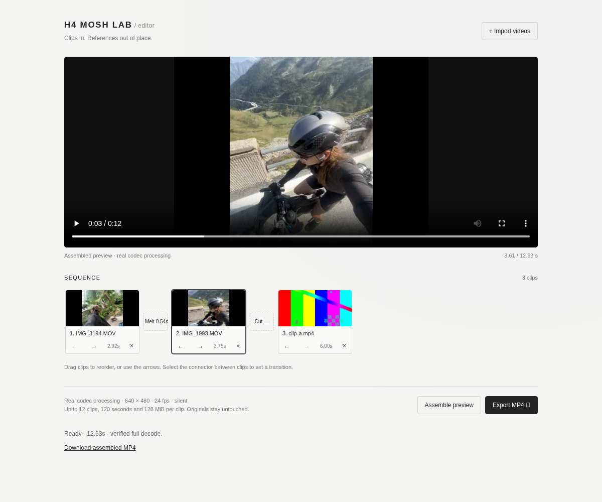
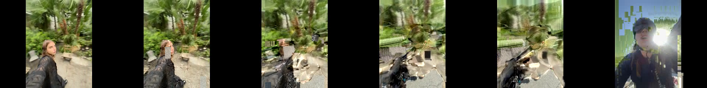

# H4 MOSH LAB

## Minimal local editor

Import multiple clips, reorder, set real Classic Mosh / Frame Melt transitions,
assemble and scrub a verified preview, and download the same MP4.

[Run the editor on your Mac, workflow, limitations and tests](EDITOR.md)



```sh
python3 tools/server.py --port 8765
```

New processing, previews and exports use **640×480 at 24fps**. Existing demo
files below are historical 320×240 renders; re-import and render to use the new size.

No frontend build or extra runtime dependencies. The simple styling can be refined later.

Phase 2 adds a verified Frame Melt mode and a common local API while preserving
Classic Mosh. See [Phase 2 methods, tests, API and Motion Transfer blocker](PHASE2.md).

## Watch the real-footage proof

[Download/play the rendered MP4](demo/test-mosh.mp4?raw=true)



This published demo uses the two user-provided clips: 6.625 seconds total,
transition at approximately 2.9 seconds, 159 output frames. All 89 retained
B P-VOPs are byte-identical; full decoding and original-file hashes passed.
The original uploads are not included. Only this explicitly requested rendered
demo and its frame strip are committed; samples/work/output remain ignored.


One real codec-level datamoshing transition. No UI, shaders, frame blending, or
frontend dependencies. Python 3 standard library, FFmpeg and FFprobe only.

## Reproduce

From this checkout (use the existing isolated cloud checkout; no worktree needed):

```sh
python3 tools/mosh.py --synthetic
python3 tools/verify.py
```

If `samples/clip-a.mp4` or `samples/clip-b.mp4` are missing, `--synthetic` generates
only the missing files: two distinct moving FFmpeg test patterns, six seconds
each. Existing files are never replaced. For your own footage:

```sh
python3 tools/mosh.py --a /absolute/path/a.mp4 --b /absolute/path/b.mp4
python3 tools/verify.py
```

The normalizer uses up to the first six seconds of each clip, no audio.
Shorter clips are supported; both need at least two normalized frames. FFmpeg must provide the native
`mpeg4` and `libx264` encoders. No pip packages, FFglitch, GPU or paid tools needed.
Tested in Codex Cloud on Linux x86-64, FFmpeg/FFprobe 7.1.5, Python 3.

## Apple Silicon Mac

Install native Homebrew from https://brew.sh if it is not already installed. Then:

```sh
/opt/homebrew/bin/brew install ffmpeg python
export PATH="/opt/homebrew/bin:$PATH"
cd /path/to/h4moshlab
ffmpeg -version
ffprobe -version
python3 tools/mosh.py --synthetic
python3 tools/verify.py
open output/test-mosh.mp4
```

These commands use native Mac tools, not the cloud's Linux binaries. Mac execution
has not been tested here. On existing samples, omit `--synthetic` to require them.

## Exact technique

1. Preserve and SHA-256 hash the original files. Probe their streams and durations.
2. Encode temporary copies as MPEG-4 Part 2 elementary streams: 640×480, letterboxed,
   square pixels, 24 fps, YUV420p, quality 4, GOP 10000, scene threshold 0, no B-frames.
3. Locate VOP start codes `00 00 01 B6`. The next byte's high two bits identify
   I=0, P=1, B=2. Require exactly one initial I-VOP and subsequent P-VOPs in each clip.
4. Keep A's configuration prefix and all A VOPs. Discard B's configuration prefix
   and initial I-VOP. Append every remaining B P-VOP **byte for byte**.
5. Decode that manipulated stream at a regenerated 24 fps cadence. B's prediction
   now refers to A's final decoded reference, rather than B's missing I-frame.
   Motion vectors and residuals intended for B therefore deform A's imagery.
6. Encode the decoded result as H.264 MP4 for ordinary playback. The final H.264
   keyframes do not perform the effect; the preceding MPEG-4 reference substitution
   does. Retain `work/mosh.m4v` as the compressed-domain evidence.

This is I-frame removal/reference substitution, not deletion of decoded images.
`work/cut.m4v` retains B's I-VOP and produces the normal-cut control. FFglitch is
not required: FFmpeg's native MPEG-4 encoder and a small VOP splicer suffice.

## Evidence and outputs

- `output/test-mosh.mp4`: 287 frames, 11.958333 seconds, H.264, 640×480, 24 fps.
- `output/test-cut.mp4`: 288-frame ordinary-cut control.
- `output/verification.json`: source metadata, original hashes, source GOP/keyframe
  inspection, normalized VOP types, exact retained-payload equality and decode result.
- `output/mosh-frames.png` and `output/cut-frames.png`: six-frame comparison strips.
  Columns show A's last frame, then B motion at approximately 0, 0.46, 1.46, 2.96,
  and 5.46 seconds after the boundary. B comparisons account for the removed I-frame.

Historical Phase 1 cloud run (320×240 outputs): both originals H.264, 320×240, 24 fps, 6 seconds/144 frames,
with one initial keyframe each; A has 1 I/42 P/101 B, B has 1 I/40 P/103 B.
Temporary copies each have 1 I/143 P/0 B. All 143 appended B P-VOPs are unchanged.
Original SHA-256 hashes match after processing. The complete final MP4 passes
`ffmpeg -v error -xerror -i output/test-mosh.mp4 -f null -`.

Visual inspection confirms A's final test pattern persists, while B's moving
color band smears and deforms it progressively. The control immediately switches
to B's circular pattern. Five selected output frames differ from the aligned cut
by mean absolute RGB error 150–163/255. Their distance from the best global linear
blend of A's last frame and aligned B is 2.66–34.80/255. These measurements support
the visual check; the direct VOP-byte comparison establishes the codec mechanism.

## Limits

Fixed proof: six seconds per source, 640×480, 24 fps, silent, drops B's first frame.
Inputs may use codecs FFmpeg can decode; manipulation itself supports only the
script's normalized MPEG-4 Part 2 I/P stream, not arbitrary H.264/HEVC/AV1 streams.
Residuals and intra-coded macroblocks can gradually replace A; the effect depends
on source motion and is not guaranteed to look attractive on all footage.
The synthetic patterns prove reference carry-over but do not establish artistic
quality on camera footage. No Mac runtime or browser integration has been tested.
The verifier selects five frames proportionally across the second clip.

All footage, intermediates, evidence and renders are ignored by Git. Re-running
overwrites generated work/output files, but preserves source files. No services
need to stay running. To repeat the integrity/visual evidence checks, run both
commands above; do not use Python's `-O` flag, which disables assertions.

Next phase, only after reviewing the render: call this CLI from one local server
endpoint that accepts two uploaded file paths and returns the rendered MP4.
